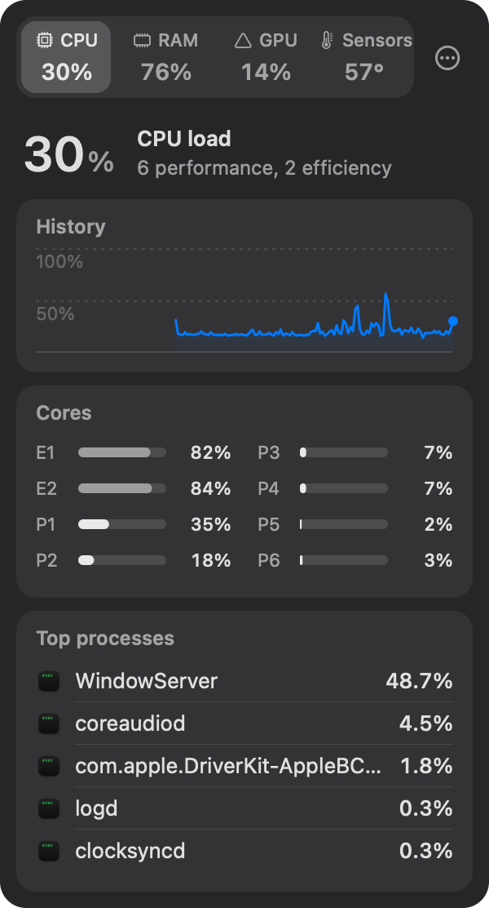
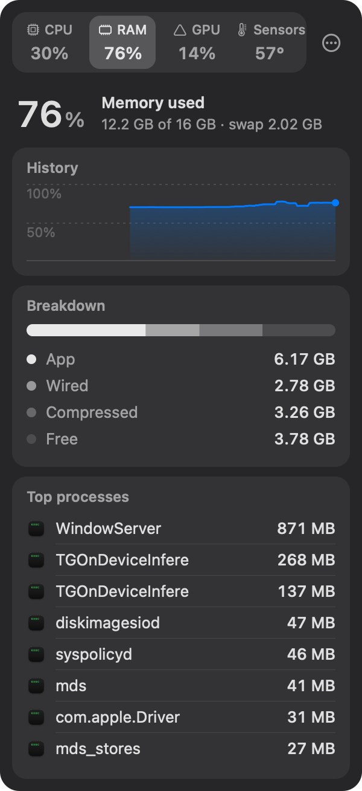
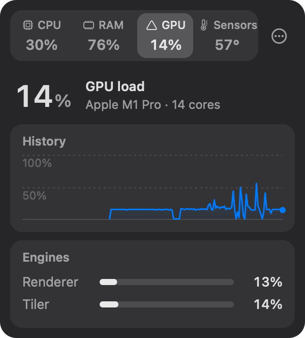
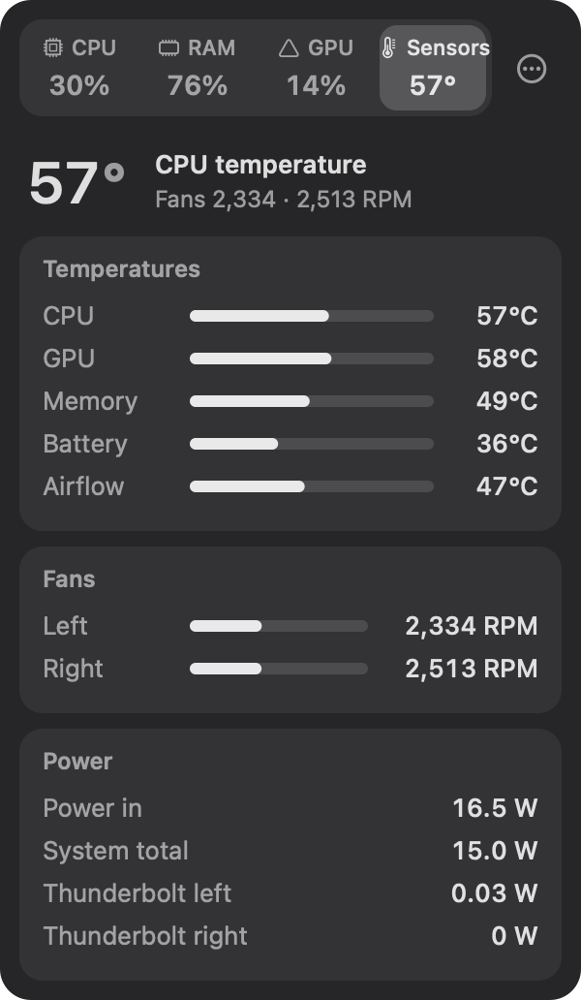

<p align="center"></p>

<h1 align="center">Watcher</h1>

<p align="center"><b>A quiet, native system monitor for your Mac's menu bar.</b><br>
CPU, memory, GPU and sensors in one menu bar item: 200 KB on disk, about 10 MB of RAM, almost no CPU.</p>

<p align="center">
  
  
  
  
</p>

## Why

Most menu bar monitors are bigger than the problems they watch for. Watcher is a native C++ app that does
the essentials well, looks at home on macOS, and stays out of the way:

|                                  | Watcher         | A typical Swift monitor (Stats 3.0.17) |
| -------------------------------- | --------------- | -------------------------------------- |
| App size on disk                 | **200 KB**      | 18 MB                                  |
| Memory, idle (Activity Monitor)  | **≈ 9 MB**      | 168–172 MB                             |
| CPU, idle (% of one core)        | **0.1–0.3 %**   | ≈ 4 %                                  |

<sub>Measured side by side on an Apple Silicon MacBook Pro running macOS 27. Watcher stays at about 10 MB while
its popup is open and after it closes, and uses up to ≈ 1 % CPU with live core bars on a busy machine. The
release download is 220 KB: GitHub builds it on macOS 26, whose code signing tool pads the signature.</sub>

Watcher is **free and open source** under the MIT License. There are no accounts, no telemetry and no ads,
and it never connects to the internet.

## What you get

**One menu bar item** that shows a number you can read at a glance, next to a small graphic:

<p align="center"></p>

live per-core bars with the total CPU load, memory in use, GPU load, or the hottest CPU temperature. It shows
whichever tab you looked at last.

**One popup** with four tabs. Point at a tab and it switches instantly: no clicks, no animations. Every tab
shows its headline number, so you rarely need to switch at all.

- **CPU**: three minutes of history, every core's load (performance and efficiency cores labelled), top 5
  processes.
- **RAM**: history, memory in use with app / wired / compressed / free, swap, top 8 processes by real memory
  footprint (the same number Activity Monitor shows).
- **GPU**: history, the GPU's name and core count, renderer and tiler load.
- **Sensors**: the hottest CPU, GPU, memory, battery and airflow sensor; fan speeds; power coming in from the
  charger, total system draw, and power through the left and right Thunderbolt ports.

The look is deliberately quiet: the native popover material, neutral greys, SF Pro with fixed-width digits,
your system accent colour on the history charts and nothing else. Red appears only when something needs
attention (90 % load or 90 °C). Light and dark mode are both supported, and temperatures follow your °C / °F
setting.

## Install

Watcher runs on Apple Silicon Macs (M1 to M5) with macOS 27 or later.

**Download:** grab `Watcher.zip` from the [latest release](../../releases/latest), unzip it and move
`Watcher.app` to Applications. The app is not notarized by Apple, so the first time you open it macOS will
ask you to confirm: open it once, then choose **Open Anyway** in System Settings → Privacy & Security.

**Or build it yourself** with the Xcode command line tools (`xcode-select --install`):

```sh
git clone https://github.com/bhaskar0210s/watcher.git
cd watcher
make install    # builds Watcher.app, copies it to /Applications and starts it
```

The first launch from `/Applications` adds Watcher to your login items. Right-click the menu bar item (or use
the ••• button in the popup) for Launch at Login, Activity Monitor, About and Quit.

## How it stays this small

- **Native all the way down.** A C++20 core reads the kernel directly: `host_processor_info` for per-core
  ticks, `host_statistics64` for memory, the GPU driver's `PerformanceStatistics` in the IORegistry, and the
  AppleSMC user client for fans, temperatures and power. A thin Objective-C++ layer owns the menu bar, and
  everything is drawn with CoreGraphics and CoreText. No third-party libraries, no web views. It is built for
  macOS 27 only, with link-time optimisation and without C++ exceptions or RTTI.
- **Only what's on screen is measured.** Temperatures, fans and power are read only while the Sensors tab is
  open (or its number is in the menu bar); processes only while the CPU or RAM tab is open.
- **Cheap process lists.** CPU uses `ps`. Memory reads your own processes straight from `libproc`, and asks
  `top` (the only way an app without admin rights can see WindowServer and other system processes) at most
  every 15 seconds.
- **Lazy repaints.** The menu bar repaints at once for real jumps and coalesces small wiggles to one repaint
  every two seconds; each repaint costs more than all the sampling, because macOS re-snapshots status items.
- **A disposable popup.** It sits on the system's own popover material. Its contents are drawn on the CPU into
  a plain image in the display's colour space, which Core Animation shows as is: letting AppKit draw it would
  make Core Animation render on the GPU from inside Watcher, which loads Metal and holds on to ≈ 6 MB for good.
  The window is destroyed as soon as it closes.

## Tested for leaks

- `leaks` (with `MallocStackLogging`) right after launch and again after 40 rounds of open popup → every tab →
  close: identical reports, with nothing from Watcher. The only entries are three `NSXPCConnection` cycles
  that Apple's AppIntents framework creates in every AppKit app at launch.
- A soak test of several minutes of popup and tab cycling followed by idle keeps memory, threads, file
  descriptors and Mach ports flat. It caught one AppKit quirk (removing a global event monitor leaks a Mach
  port), so Watcher installs its click-outside monitor once.

## Where the numbers come from

- **CPU**: user + system + nice ticks per core between two samples. Core types come from the device tree.
- **RAM**: used = active + inactive + speculative + wired + compressed − purgeable − external, the same
  accounting Activity Monitor uses; process memory is the physical footprint.
- **GPU**: `Device Utilization %`, `Renderer Utilization %` and `Tiler Utilization %` from the GPU driver.
- **Temperatures**: SMC sensor keys for each Apple Silicon generation; "hottest" is the maximum of a group's
  valid sensors.
- **Fans**: `F<n>Ac` (current) against `F<n>Mx` (maximum) RPM.
- **Power**: `PDTR` (DC in), `PSTR` (system total), `PU1R` / `PU2R` (left / right ports; the two left ports
  share one sensor).

## Development

```sh
make              # build/Watcher.app
make run          # build and start it from build/
make snapshot     # sample a few seconds, print raw readings, render every tab into docs/
make icon         # redraw resources/Watcher.icns
```

Screenshots made with `make snapshot` only ever list macOS system processes, never your own apps. Pushing a
tag such as `v1.0.1` builds the app on GitHub and publishes it as a release.

`src/core` holds the samplers (plain C++), `src/ui` the drawing, and `src/app` the AppKit shell.

## Credits

The SMC sensor key tables come from [Stats](https://github.com/exelban/stats) by Serhiy Mytrovtsiy (MIT
License, see [THIRD-PARTY-NOTICES](THIRD-PARTY-NOTICES)). Watcher is an independent app with its own design
and code.

## License

[MIT](LICENSE)
